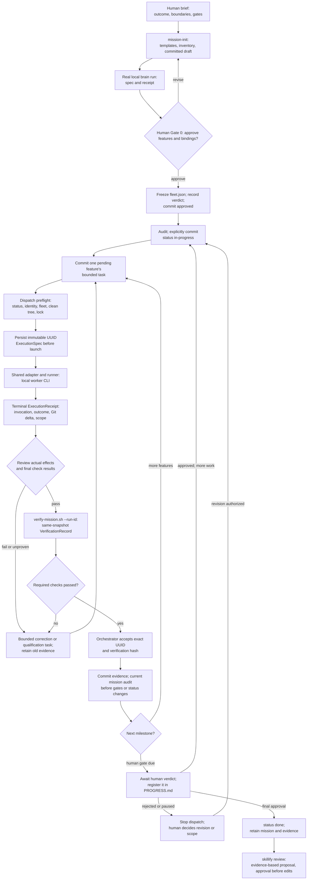
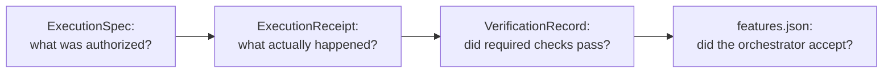
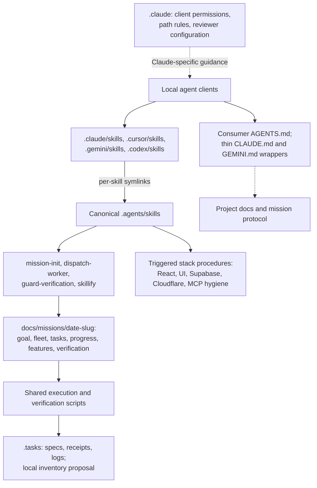
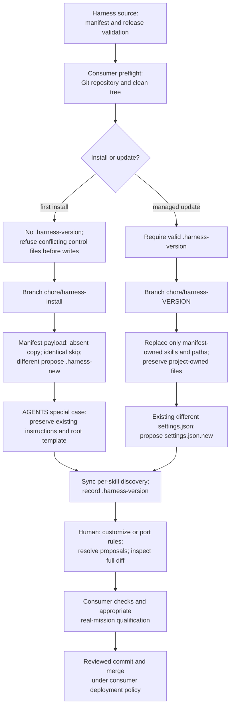
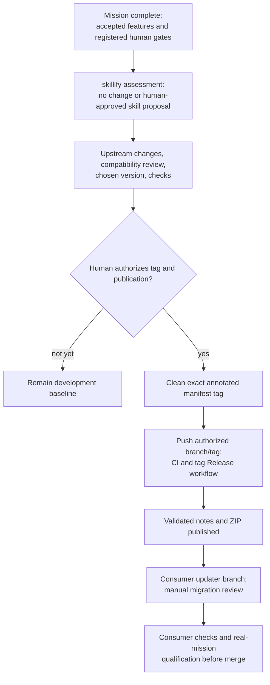

# Purrfect Harness

[](https://github.com/hashorva/purrfect-harness/releases)
[](LICENSE)
[](docs/missions/ORCHESTRATION.md)
[](https://agentskills.io)
[](https://github.com/hashorva/purrfect-harness/actions/workflows/ci.yml)

A portable mission protocol, reusable skills, and install/update tooling for
AI-assisted development. This repository **distributes the harness**; it is not
a consuming product. Each consumer keeps its own project instructions, domain
knowledge, and mission instances.

The operating loop is: human-approved intent → bounded local CLI execution →
observed workspace changes → run-specific verification → separate orchestrator
acceptance. Files and Git evidence carry the handoff, not chat memory.

## Where we are now

- **Phase 1 — Execution Truth is complete:** all seven features in the
  [mission](docs/missions/20260821-execution-truth/GOAL.md) are accepted, Human
  Gates 1 and 2 are registered, and a real authenticated consumer smoke has
  [self-contained reconstruction evidence](docs/missions/20260821-execution-truth/evidence/f007/README.md).
- **Release is a separate step:** `2.3.2` in this checkout is an untagged
  development baseline, not a final release decision. It adds the 2.3.2 fixes
  (green CI, the `cursor-agent` lane, truthful model choice) to Phase 1. The badge above reports
  the published release, which may differ. Version selection, migration review,
  tagging, publication, and real-consumer adoption remain separate work.
- **Phase 2+ is not implemented here:** no full AWU model, learning system,
  analytics, dashboard, LangGraph, ACP migration, or adaptive routing. These
  require a new scoped proposal and approval, not an extension of Phase 1.

## Mission workflow

The chair is a role, not a required vendor. The default routing policy still
names Opus; the completed Phase 1 mission explicitly used **GPT-5.6 Sol / high**
at the human's request. Provider/model/effort/speed for an active mission come
from its approved frozen fleet, not from the names in a diagram.



A failed preflight stops before provider launch. The diagram's execution branch
does not imply that every attempted dispatch produces a spec or receipt.
Human gates occur at the milestones in `GOAL.md`, not only at mission end.
Workers cannot run while status is `awaiting-gate`.

### Mission files, status, and authority

Missions live in `docs/missions/<YYYYMMDD-slug>/`, never as root-level GOAL or
feature files. Exactly one mission may be `in-progress` or `awaiting-gate`.
Resolve it with `bash scripts/active-mission.sh`.

| File | Authority |
| --- | --- |
| `GOAL.md` | Outcome, non-goals, human gates, explicit lifecycle status; its Fleet table explains the proposal |
| `fleet.json` | Immutable Gate 0-approved provider/model/effort/speed bindings; dispatch authority |
| `features.json` | Approved feature descriptions/checks and orchestrator acceptance truth |
| `tasks/T-XXX.md` | Committed, one-feature worker contract: scope, checks, attempt limit |
| `PROGRESS.md` | Durable activity, review evidence, failures, and registered human verdicts |

The status path is `draft` → `approved` → `in-progress` → `awaiting-gate` →
`in-progress` or `done`, according to the human verdict. Transitions are explicit;
the launcher never promotes `approved` automatically. Draft brain actions
`mission-init` and `gate0` permit proposed configuration; `review` runs only in
`in-progress` or `awaiting-gate` and uses the frozen brain seat. Local brain and
worker runs must leave actual CLI receipts; a current-chat chair is not a waiver.

Live `.tasks/fleet-inventory.json` is a **proposal**, not dispatch authority.
Failed probes preserve last-good provider data as degraded; fallback guesses are
labelled degraded, and unavailable providers cannot be bound. Later live probes
cannot silently change an active mission. Task `invocation:` is descriptive;
`--model`, `--effort`, and `--speed` are equality assertions against `fleet.json`,
not overrides. An alternative already-approved seat can be selected explicitly;
do not rewrite the frozen fleet to repair a dispatch.

### Worker contract and execution boundary

Dispatch from the repository root through `scripts/spawn-worker.sh`. The task
must be a committed direct file in the mission's `tasks/` directory; filename
stem, `task_id`, feature, and `--feature` must match one `passes: false` feature.
Use the [worker template](docs/missions/templates/WORKER_TASK.template.md).

- `Files you MAY touch` uses backtick-quoted repository-relative path/glob
  bullets. Include `PROGRESS.md` if the worker must update it.
- `Verification commands` uses consecutive code-span bullets containing
  non-empty JSON argv arrays, as shown below. These are executable checks, not
  prose or shell command strings.
- The worker reads the task, instructions, named skills, mission state, and Git
  history; establishes a green baseline; implements one feature; adds a negative
  regression for every reproduced failure; runs checks; records progress; and
  commits the scoped change and progress entry together, leaving a clean tree.
- The worker never dispatches another worker, edits `features.json` or
  `fleet.json`, accepts its own work, or advances mission gates/status.

Example task verification bullet:

```markdown
- `["bash","tests/run-tests.sh"]`
```

For a frozen Codex economy seat with **medium effort and unknown speed**, the
orchestrator dispatches as follows (replace the task/feature placeholders):

```bash
MISSION=$(bash scripts/active-mission.sh)
bash scripts/spawn-worker.sh codex "$MISSION/tasks/T-XXX.md" \
  --tier economy --feature F00X --attempt 1 --effort medium --speed unknown
```

Use the actual approved seat values; this example cannot rebind a different
fleet. The launcher prints the run UUID. Follow
[mission-init](.agents/skills/mission-init/SKILL.md) for draft brain execution and
Gate 0 freezing, and [dispatch-worker](.agents/skills/dispatch-worker/SKILL.md)
for dispatch/review, correction tasks, and exact-run acceptance.

Phase 1 runs in **one repository**. External `--repo` targets are rejected.
A clean starting tree and an exclusive workspace lock prevent concurrent
launcher writers; the lock lasts through terminal receipt creation. Do not run
a verifier or make review/progress edits alongside a worker. This is not a
general scheduler or a filesystem sandbox: scope checks cover **Git-visible
changes in the declared workspace**, not arbitrary outside or ignored files.

The shared provider adapter and runner own argv construction, lifecycle, and
receipt creation for `codex`, Cursor (`cursor-agent`), `agy`, and `claude`. Receipts record
`completed`, `failed`, `timed_out`, `interrupted`, or `launch_failed` outcomes.
Timeout/interruption includes provider process-tree cleanup. Brain and worker
timeouts default to 2400 seconds; their `SPAWN_BRAIN_TIMEOUT_SECS` and
`SPAWN_WORKER_TIMEOUT_SECS` settings control this. Exit zero is not proof of a
workspace change or a completed feature. Unobserved provider values stay
`unknown`, rather than being inferred from requested settings.

### Four distinct truths, one run



| Artifact | Location and binding |
| --- | --- |
| Immutable ExecutionSpec | `.tasks/specs/<uuid>.json`, persisted before launch; binds mission, feature/work unit, attempt, workspace, configuration, and write scope |
| Terminal ExecutionReceipt | `.tasks/receipts/<uuid>.json`, linked to exact spec bytes; records safe invocation evidence, outcome/exit, Git before/after, commits, changed paths, workspace-change and scope results |
| Immutable VerificationRecord | `<mission>/verification/<uuid>.json`, linked to exact spec/receipt bytes and committed task checks for that snapshot |
| Orchestrator acceptance | `features.json`: `accepted_run_id`, `accepted_verification_sha256`, `accepted_at`, `accepted_by`, and `passes: true` |

There is no separate `acceptance.json`. Provider logs are under
`.tasks/logs/<uuid>.log`; retain the launcher UUID, not “the latest successful
receipt.” Current ExecutionSpec v3 uses provider contract 2; historical v1/v2
evidence retains contract 1 semantics instead of being reinterpreted by new flags.

After reviewing effects, **before any further Git-visible change**, verify and
accept the exact worker run. Set `MISSION` and `RUN_ID` to the actual mission and
UUID printed by the launcher:

```bash
bash scripts/verify-mission.sh --run-id "$RUN_ID" "$MISSION"
VERIFICATION_SHA256=$(python3 -c 'import hashlib,sys; print(hashlib.sha256(open(sys.argv[1],"rb").read()).hexdigest())' \
  "$MISSION/verification/$RUN_ID.json")
bash scripts/accept-feature.sh --run-id "$RUN_ID" \
  --verification-sha256 "$VERIFICATION_SHA256" --accepted-by "orchestrator identity" "$MISSION"
bash scripts/verify-mission.sh --require-workers "$MISSION"
```

Verification executes the JSON argv checks from the task at the receipt's base
commit. The current Git snapshot must equal the receipt's after snapshot both
before and after checks. Passing verification does **not** accept a feature.
Only the orchestrator accepts after review and a passing record, then commits
verification, acceptance, and progress. Run the current mission audit before
any gate/status advance; register the human verdict in `PROGRESS.md`.

If a brain review or later progress commit moved the snapshot before verification,
use a bounded qualification task for the same pending feature and a new run.
Never edit old specs, receipts, or records to fit later state. Failed, no-op,
unrelated, null-evidence, or legacy runs cannot substitute for current acceptance.
Declare `bootstrap: true` authoring-only exemptions before Gate 0; they are not
a loophole for code whose worker failed.

### Real end-to-end proof

Phase 1 did not finish at unit-test green. A disposable consumer installed the
candidate in explicit development mode, froze an approved real economy seat,
and used authenticated Codex/Luna to change and commit one nonce-bearing file.
That run was verified and separately accepted. The
[F007 archive](docs/missions/20260821-execution-truth/evidence/f007/README.md)
contains the fleet, task, spec, receipt, VerificationRecord, feature acceptance,
sanitized log, hash manifest, and full consumer Git bundle.

A fresh process can reconstruct authorization → invocation → actual Git change
→ verification → acceptance without the original temporary repository or chat:

```bash
PYTHONDONTWRITEBYTECODE=1 python3 docs/missions/20260821-execution-truth/evidence/f007/reconstruct.py
PYTHONDONTWRITEBYTECODE=1 bash docs/missions/20260821-execution-truth/evidence/f007/test-reconstruct.sh
```

Expect reconstruction `"result": "PASS"` and `RECONSTRUCTION TESTS PASSED`;
the regression checks include tampering and acceptance rebinding. Ordinary
`.tasks/` evidence is machine-local; a local parent-mission audit needs those
files. A fresh clone uses this curated archive. Do not indiscriminately commit
provider transcripts, credentials, or unsanitized runtime evidence.

## Portable layers and discovery

| Layer | What belongs there |
| --- | --- |
| `AGENTS.md` | Short repository rules and pointers; project-specific consumer instructions |
| `docs/` | On-demand architecture, domain, design, and other knowledge |
| `.agents/skills/` | Canonical reusable procedures, loaded when their triggers match |
| `docs/missions/` | Protocol/templates plus durable project-owned mission state |

Runtime `.tasks/` evidence complements those layers; it is not a second mission
state machine. Use `features.json` for acceptance, not an agent's self-report.



`scripts/sync-skills.sh` consumes the manifest to create individual symlinks in
real discovery directories. It replaces a legacy parent link such as
`.claude/skills -> ../.agents/skills` safely and preserves foreign discovery
entries. New consumer skills belong outside the manifest-owned skill names.

Reusable skills use the [Agent Skills format](https://agentskills.io). Keep
procedure details out of always-loaded rules and domain knowledge out of shared
skills. The `mcp-hygiene` procedure keeps external queries scoped and persists
needed evidence instead of filling mission context with connector output.

### Claude Code client permission configuration

`.claude/settings.json` is a **client permission configuration**, not an absolute
security boundary. Its requested allow/deny rules, credential-read restrictions,
and any project-specific hooks depend on client behavior. Portable repository
rules, task scope, review, and verification apply across all providers.

`.claude/rules/` contains path-gated pointers to relevant skills/docs.
`.claude/agents/code-reviewer.md` configures a reviewer with Read/Grep/Glob tools
and PASS/FAIL findings; it is not proof of physical containment or mandatory
delegation to that client. MCP connections, local settings, and personal memory
are project/user concerns, not shared harness payload assumptions.

## Installing and updating consumers

Run these tools **from the harness clone**, targeting a clean Git repository
with a baseline commit. Normal propagation requires a clean source at the
manifest's exact **annotated release tag on HEAD**. `--dev` or
`--allow-untagged` is only for explicit local development/smoke work, not normal
consumer adoption. Neither installer nor updater commits or merges for you.

```bash
# First install, from a clean published tagged harness source:
bash scripts/install-harness.sh /absolute/path/to/consumer
# Later update of a managed consumer, from that kind of source:
bash scripts/update-harness.sh /absolute/path/to/consumer
# Explicit local development/smoke only; not a published release:
bash scripts/install-harness.sh --dev /absolute/path/to/disposable-consumer
```



### First install: new or existing project

`install-harness.sh` refuses an already-managed target. Existing consumer
`harness-manifest.json`, `scripts/harness-manifest.py`, or
`scripts/sync-skills.sh` (including symlinks) are hard conflicts: it refuses
**before writes**, rather than installing around an untrusted control file.
For other payload files, absent → copy, byte-identical → skip, different →
`<path>.harness-new` proposal; the existing file stays intact.

`AGENTS.md` is stricter: an existing file is neither overwritten nor proposed
against. If it exists and root `AGENTS.md.template` is absent, the consumer
skeleton is copied to that template for manual porting. If both exist, both
remain untouched. If AGENTS is absent, the skeleton becomes `AGENTS.md`.
The source is `docs/templates/AGENTS.md.template`, never this harness's own AGENTS.

For a new project, fill the skeleton's stack, commands, boundaries, and mission
rules. For an existing project, manually port applicable workflow changes while
preserving its instructions. Keep shared skill changes upstream and consumer
specifics in project docs or foreign skills. Removing an unused manifest-owned
skill is not permanent pruning: an update restores it. Prefer leaving optional
procedures dormant unless their trigger applies.

### Update: ownership decides what may change

`harness-manifest.json` is the single distribution ownership source; these groups
explain the policy, not a second hand-maintained payload list:

| Owner/treatment | Examples and behavior |
| --- | --- |
| Harness-owned, replaced on update | Manifest-named canonical skills, protocol/templates, helper scripts, schemas, manifest, Claude rule/reviewer stubs |
| Project-owned, preserved | Root `AGENTS.md` and `AGENTS.md.template`, existing `CLAUDE.md`/`GEMINI.md`, product docs, dated mission instances, foreign skills |
| Manual merge | Existing different `.claude/settings.json` produces `.claude/settings.json.new`; a missing file gets the baseline |
| Management marker/discovery | `.harness-version` records the installed version; manifest-owned per-skill links are refreshed while foreign discovery entries survive |

Harness-owned directories and named skills are replaced as units, not merged
with consumer customizations. Put local additions in project-owned locations.
The updater refuses a missing or invalid `.harness-version`. It preserves old
mission evidence; it does not migrate it or invent missing UUID/acceptance fields.
Legacy evidence may fail the current strict audit. Review project-owned mission
rules manually and start new work from the current templates/frozen fleet.

README, CHANGELOG, and release instructions stay in this distribution repository;
they are not copied wholesale into the consuming product.

### Consumer review checklist

- [ ] Inspect full `git diff` and untracked additions, including proposed files;
  every change is explained by the manifest, discovery, or deliberate customization.
- [ ] Resolve all `.harness-new` and `settings.json.new` proposals before merging.
- [ ] Fill new AGENTS placeholders or manually port workflow rules into existing
  project instructions; keep those rules short and point to detailed docs.
- [ ] Check per-skill links resolve in all four discovery directories, and confirm
  the intended client actually discovers the procedures.
- [ ] Preserve foreign skills, project instructions, and mission instances;
  confirm `.harness-version` records the intended candidate/release.
- [ ] Review client settings for this project's actual commands and risks.
- [ ] Run project checks. For workflow adoption, qualify a small real mission;
  file-copy success alone is not execution proof.
- [ ] Commit and merge on the consumer's review/deployment path; do not bypass
  its normal gates or assume this harness authorizes deployment.

## Repository map and checks

| Path | Role |
| --- | --- |
| `harness-manifest.json`, `scripts/harness-manifest.py` | Distribution ownership, version/tag validation, install/update/sync inputs |
| `docs/missions/README.md`, `ORCHESTRATION.md`, `MODEL_ROUTING.md` | Mission protocol, authority, routing preferences |
| `docs/missions/templates/`, `docs/templates/AGENTS.md.template` | Worker/mission formats and consumer instruction skeleton |
| `.agents/skills/`, `scripts/sync-skills.sh` | Canonical procedures and manifest-driven discovery |
| `scripts/fleet-inventory.sh`, `scripts/fleet_state.py` | Live proposal/probe health, approved fleet freeze/validation/resolution |
| `scripts/spawn-brain.sh`, `scripts/spawn-worker.sh` | Role-aware local CLI launchers |
| `scripts/dispatch_policy.py`, `execution_spec.py`, `execute_provider.py`, `execution_runner.py`, `execution_receipt.py` | Preflight/lock, immutable authorization, shared adapter/lifecycle, terminal evidence |
| `scripts/verify-mission.sh`, `verification_record.py`, `accept-feature.sh` | Exact-run verification, mission audit, separate orchestrator acceptance |
| `schemas/`, `tests/` | Artifact contracts and mounted positive/negative regressions |
| `docs/missions/20260821-execution-truth/` | Completed Phase 1 mission, reviews, acceptance, and smoke archive |
| `docs/RELEASING.md`, `docs/PUBLISHING.md`, `.github/workflows/` | Release/adoption procedure and CI/publication entry points |

From the harness root:

```bash
shellcheck scripts/*.sh tests/*.sh
git ls-files -z '*.json' | xargs -0 -n 1 sh -c 'python3 -m json.tool "$1" >/dev/null' sh
PYTHONDONTWRITEBYTECODE=1 bash tests/run-tests.sh
bash scripts/install-harness.sh --dev --validate-release
git diff --check
```

Require the final `ALL TESTS PASSED` banner, not partial output. The suite uses
isolated tagged/untagged fixtures and real entry points for dispatch, provider
contracts, terminal receipts, scope, verification/acceptance, installation,
ownership, and release validation. The guard-verification procedure additionally
requires the intended violation to reach and fail the intended guard, rather than
an unrelated setup error. Archived smoke reconstruction is a separate check.

## Mission completion is not automatic release



At mission end, `skillify` reviews repeated evidence, not speculative lessons.
Graduation needs recurrence, deterministic steps, verifiable results, and no
existing coverage. Prefer a patch to an existing procedure; present the full
proposal and obtain human approval before changing skills. This is a reviewed
improvement loop, **not an automatic learning system**.

For release, choose the version from actual consumer compatibility under
[RELEASING.md](docs/RELEASING.md), then align README, CHANGELOG, and manifest.
Cross-repository dispatch removal and stricter mission evidence require migration
review; neither an automatic major bump nor the current development number is
assumed. Tags, remote changes, publication, and consumer propagation need their
own authorization. Never move/delete a published tag.

The tag-triggered Release workflow validates the exact manifest tag, extracts
the top changelog entry, builds the ZIP, and publishes the GitHub Release.
Do not create a duplicate manual release. Inspect successful CI/release results,
then update selected consumers from the published clean tagged source, review
project-owned instructions, and qualify actual workflow behavior before merging.
